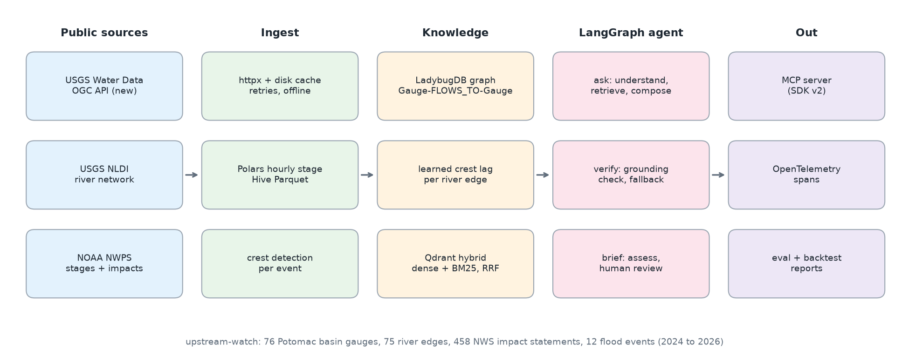
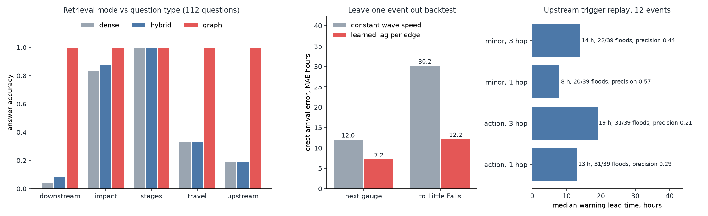
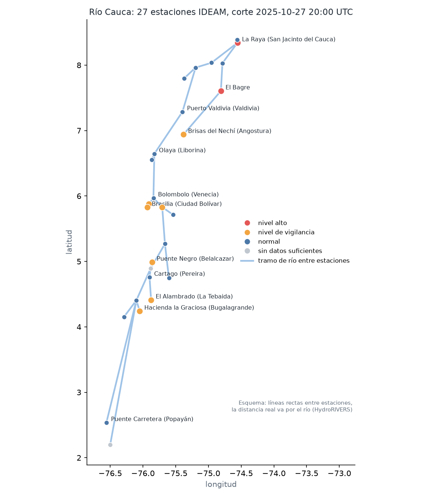

# upstream-watch

Upstream river gauges as early warning for the places downstream. The project turns 76 public
river gauges in the Potomac basin into a knowledge graph, learns how long a crest takes to travel
along each river segment from twelve real flood events, and puts a LangGraph agent on top that
answers duty officer questions with citations and drafts flood watch briefs that a person has to
approve.

Everything runs on a laptop CPU with public data and no API keys. The same engine also runs on
the Cauca river in Colombia with IDEAM sensors and answers in Spanish
([guía en español](docs/COLOMBIA.md)).



## The problem

When a storm hits the headwaters of the Potomac, the gauges in western Maryland and West
Virginia see the water first. Little Falls, just above Washington DC, sees it a day or two later.
The information to warn the people in between is already public: USGS publishes the readings
every 15 minutes and the National Weather Service publishes, for each gauge, the stage at which
a towpath, a road or a campground goes under. It is just spread across hundreds of pages and
three different APIs, and nobody has it as one connected picture.

A duty officer needs three answers fast:

1. What is flooded at this gauge at this stage, and how bad is it?
2. Where does this water go next, and when does it get there?
3. Which gauges upstream should I be watching for this town?

The second and third questions are about the shape of the river network. That is exactly where a
plain vector search falls apart, so this project measures it.

## Why now

* **USGS is retiring the legacy WaterServices API.** The 17 September 2026 bulletin sets the
  schedule: degradation of waterservices.usgs.gov starts in November 2026, planned outages in
  January 2027, and the service is decommissioned on 22 February 2027
  ([USGS bulletin](https://content.govdelivery.com/accounts/USDOIGS/bulletins/42b03d7),
  [WDFN blog, updated 17 October 2026](https://waterdata.usgs.gov/blog/api-waterservices-decom/)).
  Every pipeline still calling the old endpoints has a few weeks left. This project is built on
  the new OGC API at api.waterdata.usgs.gov from the start.
* **Human in the loop got typed in LangGraph.** langgraph 1.2.12 (21 September 2026) lets
  `interrupt()` take a `response_schema`, so a paused run tells the client exactly what answer it
  expects and rejects a malformed one without losing the pause. 1.2.18 shipped on 26 October 2026
  ([release summary](https://www.developersdigest.tech/blog/langchain-langgraph-whats-new-2026)).
  The brief approval step here uses it.
* **Embedded graph databases moved on.** After the Kuzu repository was archived in October 2025,
  LadybugDB continued it as an MIT licensed fork with the same Cypher engine
  ([DBDB entry](https://dbdb.io/db/ladybugdb)). It is used here instead of a Neo4j container.

## Data

| Source | What | License | Downloaded |
|---|---|---|---|
| [USGS Water Data OGC API](https://api.waterdata.usgs.gov/ogcapi/v0) | Daily mean discharge at Little Falls (Oct 2023 to Oct 2026) to find events, 15 minute gage height for every gauge in each event window | US public domain | 2026-11-03 |
| [USGS NLDI](https://api.water.usgs.gov/nldi) | NHDPlus flowlines downstream of each gauge, used to build the river network and distances | US public domain | 2026-11-03 |
| [NOAA NWPS](https://api.water.noaa.gov/nwps/v1) | Forecast points, flood category stages, record crests and 458 impact statements | US public domain | 2026-11-03 |
| [IDEAM Nivel Instantáneo del Río](https://www.datos.gov.co/resource/bdmn-sqnh) | Colombia region: river level readings of 27 automatic stations in the Cauca basin, Nov 2022 to Nov 2026 | CC BY-SA 4.0 | 2026-11-03 |
| [HydroRIVERS v1.0](https://www.hydrosheds.org/products/hydrorivers) | Colombia region: river network to connect the stations (Lehner and Grill, 2013) | HydroSHEDS license | 2026-11-03 |

`python -m upstream_watch ingest` downloads everything (about 1,400 cached requests) into
`data/raw` and writes the curated set to `data/curated`. The curated set is small, 700 KB, so the
whole thing ships in `data/sample/` and the full results below reproduce from a fresh clone with
no network.

No people, no personal data: only gauge readings and public infrastructure descriptions.

## How it works

1. **Network.** List NWPS forecast points in the basin box, keep the ones with a USGS site and a
   minor flood stage, and ask NLDI for the flowlines downstream of each. A gauge belongs to the
   basin if its downstream path reaches the Little Falls flowline. The next gauge downstream and
   the river distance come from walking that path (NLDI does not order flowlines, so the chain is
   rebuilt from the line geometry). Result: 76 gauges, 75 edges, a single tree.
2. **Events and stage.** Twelve independent high flow events are detected from the Little Falls
   daily discharge (peaks above 35,000 cfs, ten days apart). For each event the 15 minute gage
   height of every gauge is pulled from the new OGC API, averaged to hourly with Polars and
   written as Hive partitioned Parquet (196,674 rows).
3. **Crest lags.** A crest is the highest hourly stage with at least 1 ft of rise that is not on
   the edge of the window. For each edge the median crest to crest lag over past events is its
   travel time; 71 of 75 edges have one, the other 4 fall back to the basin median wave speed
   (4.0 km/h).
4. **Graph.** LadybugDB holds `Gauge`, `River` and `Impact` nodes and `FLOWS_TO` edges with distance
   and lag. One variable length Cypher path query returns every downstream gauge with cumulative
   arrival time.
5. **Index.** Each flood stage table, impact statement and river segment becomes a document in an
   in process Qdrant collection with a dense vector (bge-small-en-v1.5 through fastembed on ONNX)
   and a BM25 style sparse vector, fused with RRF.
6. **Agent.** A LangGraph graph with two flows. `ask`: understand, retrieve (dense, hybrid or
   graph), compose with citations, verify that every number and citation is in the context.
   `brief`: take a snapshot of live readings, list every gauge at or above action stage with its
   NWS impact and downstream arrival times, then pause on an `interrupt` with a typed
   `ReviewDecision` until a person approves or rejects. Every node is an OpenTelemetry span.
7. **MCP.** The same graph is exposed as an MCP server (Python SDK v2, `MCPServer`) with four read
   only tools: `gauge_info`, `downstream_eta`, `impacts_at`, `ask_question`.

Design decisions are in [docs](docs/):
[ADR 001 LadybugDB](docs/adr-001-ladybugdb-for-the-river-graph.md),
[ADR 002 graph first retrieval](docs/adr-002-graph-first-retrieval.md),
[ADR 003 lags, grounding and review](docs/adr-003-learned-lags-grounding-and-review.md),
[ADR 004 Colombia region](docs/adr-004-colombia-region.md).

## Results

All numbers come from `python -m upstream_watch run` on 3 November 2026, Python 3.13, 2 vCPU,
fastembed bge-small-en-v1.5, deterministic writer (`UPW_LLM_PROVIDER=rule`). The run takes
about 80 seconds. Raw numbers are in `reports/metrics.json`.



**Retrieval: same agent, same writer, three retrievers**

128 questions: 112 generated from the data (24 per type, 16 for upstream) and 16 typed by hand
the way a duty officer would, with short place names and station ids ("How many hours from
Shepherdstown to Little Falls?"). An answer counts as correct only if it cites the right document
and states the right category, threshold, travel time or gauge names.

| Retriever | Answer accuracy, generated | Answer accuracy, hand written | Context recall | p50 latency |
|---|---|---|---|---|
| Dense (bge-small) | 0.500 | 0.250 | 0.733 | 29 ms |
| Hybrid (dense + BM25, RRF) | 0.518 | 0.188 | 0.739 | 39 ms |
| **Graph + hybrid in scope** | **1.000** | **1.000** | **1.000** | 62 ms |

By question type (generated set), dense and hybrid do well on single document questions (flood
stages 1.00, impacts 0.83 and 0.88) and collapse on topology: downstream 0.04 and 0.08, upstream
0.19, travel time 0.33. Hybrid search does not fix that, it only helps when the question shares
rare words with one document. Every answer in every mode passed the grounding check, so the
failures are honest "the retrieved context does not contain" answers, not made up numbers.

The graph scoring 1.000 needs a caveat: the generated questions come from the same graph. The hand
written set is there to check the entity linker on short names; it also scores 16 of 16, but it
is small.

**Crest arrival times, leave one event out** (660 edge observations, 12 events)

| Target | Constant wave speed | Learned lag per edge |
|---|---|---|
| Next gauge downstream, MAE | 12.0 h | **7.2 h** (median 3.0 h) |
| Little Falls from any gauge, MAE | 30.2 h | **12.2 h** (median 8.5 h) |

**Warning lead time.** Replaying all 12 events hour by hour: for every gauge that reached minor
flood (39 cases), when did a gauge upstream first cross its own trigger stage?

| Trigger | Floods warned in advance | Median lead time | Alarm precision |
|---|---|---|---|
| Action stage, 1 hop up | 31 of 39 | 13 h | 0.29 |
| Action stage, up to 3 hops | 31 of 39 | 19 h | 0.21 |
| Minor flood, 1 hop up | 20 of 39 | 8 h | 0.57 |
| Minor flood, up to 3 hops | 22 of 39 | 14 h | 0.44 |

That table is the real trade off of an upstream watch: an action stage trigger warns early for
four out of five floods but most of its alarms do not end in flooding downstream, a minor flood
trigger is twice as precise and catches about half.

**Brief replay, May 2025 western Maryland flood.** At 09:00 UTC on 14 May 2025, the busiest hour,
22 of 75 reporting gauges were at or above action stage. The brief listed them with their NWS
impact and the next three gauges downstream. For the 64 downstream crests that were still ahead,
the quoted arrival time was off by 6.8 h on average (median 5.5 h). The run paused for review and
resumed with a typed approval. Text in `reports/brief.txt`.

**What a small local model changes.** `python -m upstream_watch llm-check` runs graph mode on
41 questions (5 generated per type plus the 16 hand written). Same retriever, only the writer and
the intent parser change. Qwen2.5 0.5B Instruct in process on 2 vCPU, greedy decoding:

| Writer | Answer accuracy | Intent parsed right | Grounding check failed, draft used | p50 per question |
|---|---|---|---|---|
| Deterministic templates | 1.000 | 1.000 | 0 percent | under 0.1 s |
| Qwen2.5 0.5B (`UPW_LLM_PROVIDER=local`) | 0.317 | 0.707 | 12.2 percent | 19.9 s |

The small model misread the question type on 12 of 41 questions (it called an impact question an
upstream question, for example), and its rewrites often dropped the citation or the exact
category the checker looks for. In 5 answers the verify node found a number or a citation that
was not in the context and returned the deterministic draft instead. That is why the deterministic
writer is the default and a model is optional: on this task the model adds latency and risk, and
the value is in retrieval and in the checks around it.

## Colombia: río Cauca

`--region cauca` runs the same graph, agent, review step and evaluation on 27 IDEAM automatic
stations from Popayán to San Jacinto del Cauca, with answers, briefs and figures in Spanish. The
full guide, written for disaster risk teams, is in [docs/COLOMBIA.md](docs/COLOMBIA.md).

What had to change, because Colombia publishes the readings but not the rest as open data:
the river network comes from HydroRIVERS, the levels are statistical (90th and 98th percentile
of daily maximum, labelled as not official), and quality gates run before any number is computed
([ADR 004](docs/adr-004-colombia-region.md)).



| Result (3 November 2026 run) | Value |
|---|---|
| Graph retrieval, generated / hand written questions in Spanish | 79 of 79 / 12 of 12 |
| Plain vector search, same questions | 57 / 67 percent |
| Brief replay, 27 Oct 2025: crest arrival error on 12 downstream crests | 5.0 h mean, 3.4 h median |
| Crest arrival at La Raya, leave one event out | 23.0 h, same as a constant wave speed (23.2 h) |
| Upstream trigger, 31 high water cases | 12 warned, 15 h median lead, precision 0.18 |

The honest reading: the network and the reviewed brief are useful now; learned travel times and
automatic alarms are not, with four years of gappy data and regulated reservoirs. The data
quality findings are listed in the guide: one station with a 29 m datum shift, one repeating a
flag value, one with two locations, six with less than a year of history.

## Run it

```bash
python -m venv .venv && source .venv/bin/activate
make install          # package with dev tools
make run              # full evaluation on the bundled data, writes reports/
make test             # 50 tests, under 10 seconds
make smoke            # same run with the no download embedder, used in CI
make data             # optional: download everything again from USGS and NOAA
make run-co           # Colombia, río Cauca, on the bundled IDEAM data (Spanish)
make brief-co         # Spanish flood watch brief for the 27 Oct 2025 event
UPW_LLM_PROVIDER=local python -m upstream_watch llm-check   # same checks with a local model
```

Ask a question or replay a brief:

```bash
python -m upstream_watch ask "Little Falls just hit 11.7 feet. What is under water?"
python -m upstream_watch ask "How many hours from Shepherdstown to Little Falls?" --mode dense
python -m upstream_watch brief --event 2025-05-15            # stops at the review step
python -m upstream_watch brief --event 2025-05-15 --approve --reviewer "duty officer"
python -m upstream_watch mcp                                  # MCP server over stdio
```

Settings are environment variables with the `UPW_` prefix, see `.env.example`. To use a model
instead of the deterministic writer: `UPW_LLM_PROVIDER=local` (transformers on CPU, install with
`pip install -e ".[local-llm]"`), `ollama`, or `openai` for any OpenAI compatible server.

## Repository layout

```
upstream_watch/   package: sources, network, timeseries, colombia, hydro, graph, retrieval, llm, lang,
                  answer, agent, telemetry, evaluate, replay, mcp_server, report, pipeline, cli
tests/            unit tests per module, agent and review flow, MCP in process, eval smoke
data/sample/      curated gauges, edges, events and one hourly stage Parquet file (the full dataset)
data/sample_cauca/ the same for the Colombia region, with quality.json
docs/             architecture and results figures, ADRs
.github/          CI: ruff, pytest, smoke run
```

## Limitations

* Crest lags are statistics over twelve events, not hydraulic routing. They do not know about
  rainfall still falling, reservoir releases (Jennings Randolph, Savage River) or backwater, and
  small creeks feeding a main stem gauge give noisy lags. Operational forecasts from the Middle
  Atlantic River Forecast Center remain the reference; this is a decision support layer next to
  them.
* The brief predicts timing, not magnitude. Adding a peak stage regression per edge, or reading
  the NWPS forecast hydrographs, is the next step.
* Twelve events, all from 2024 to 2026 because that is the window used for event detection. Older
  events are available from the same API and would tighten the lags.
* The generated evaluation questions come from the graph itself. A larger hand written set from
  real forecast desk questions would be the fair test.
* One basin. The ingest is generic (any NWPS box and outlet flowline), but thresholds and
  aliases were only checked here.

## License

MIT, see [LICENSE](LICENSE). USGS and NOAA data are US Government works in the public domain.
The IDEAM sample in `data/sample_cauca/` keeps its CC BY-SA 4.0 license.
