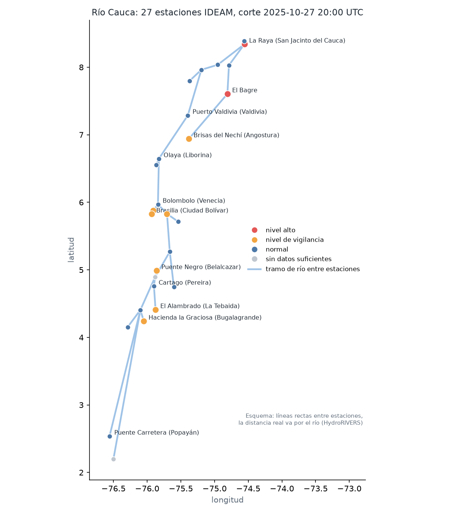

# upstream-watch para Colombia: río Cauca

Guía corta en español para equipos de gestión del riesgo (IDEAM, UNGRD, consejos departamentales y municipales de gestión del riesgo, alcaldías) y para cualquier persona que quiera usar o adaptar este proyecto.



## Qué hace, en tres frases

1. Toma los niveles de los ríos que el IDEAM publica casi en tiempo real en datos.gov.co y los ordena como una red: qué estación está aguas arriba de cuál y a cuántos kilómetros por el río.
2. Cuando una estación sube, dice qué municipios siguen aguas abajo y en cuántas horas puede llegar la creciente.
3. Responde preguntas en español, siempre citando de dónde sale cada dato, y prepara un boletín que una persona debe aprobar antes de enviarlo.

Es código abierto (licencia MIT), corre en un computador normal, no necesita claves ni servicios pagos.

## Cómo se usa

Necesita Python 3.11 o superior.

```bash
pip install -e .
python -m upstream_watch --region cauca brief
python -m upstream_watch --region cauca ask "Puerto Valdivia marca 6 metros, ¿cómo está?"
```

El primer comando instala. El segundo muestra un boletín con los datos de una creciente real (27 de octubre de 2025) y se detiene para que alguien lo apruebe. El tercero responde una pregunta.

Para descargar los datos más recientes del IDEAM y reconstruir todo:

```bash
pip install -e ".[colombia]"
python -m upstream_watch --region cauca ingest
```

## Ejemplo de boletín

Datos reales del 27 de octubre de 2025, 20:00 UTC:

```
9 estaciones en nivel de vigilancia o superior, primero las más altas:
- La Raya (San Jacinto del Cauca) (25027910) 12.62 m, en nivel alto. Siguen: Las Varas (San Jacinto del Cauca) ~1.2 h.
- El Bagre (2625700231) 8.01 m, en nivel alto. Siguen: La Esperanza Nechí (Nechí) ~6.8 h, La Raya (San Jacinto del Cauca) ~13.6 h.
- Puente Iglesias (Fredonia) (26207030) 4.69 m, en nivel de vigilancia. Siguen: Bolombolo (Venecia) ~3.3 h, Olaya (Liborina) ~14.1 h.
...
```

## Ejemplos de preguntas

```
¿Cuánto tarda una creciente en llegar de Puerto Valdivia a La Raya?
Olaya está subiendo, ¿hacia dónde va el agua aguas abajo?
¿Qué estaciones aguas arriba debo vigilar para La Raya?
¿Cuál es el umbral de nivel alto en La Coquera?
```

Cada respuesta trae entre corchetes el documento del que sale, por ejemplo [stages:26237040]. Si el sistema no encuentra el dato, lo dice en vez de inventarlo.

## Qué NO hace

* No reemplaza las alertas oficiales del IDEAM ni de la UNGRD. Es una herramienta de apoyo.
* Los niveles de referencia ("vigilancia" y "alto") son estadísticos: el percentil 90 y el 98 del nivel máximo diario de cada estación desde noviembre de 2022. No son los umbrales oficiales, porque esos no están publicados como datos abiertos por estación. Si el IDEAM los compartiera, el sistema los usaría directamente.
* No predice cuánto va a subir el río, solo hacia dónde va la creciente y en cuánto tiempo aproximado.
* Depende de que los sensores estén reportando bien.

## Resultados medidos (corrida del 3 de noviembre de 2026)

* 27 estaciones automáticas del IDEAM en la cuenca del Cauca, desde Popayán hasta San Jacinto del Cauca, unidas por 26 tramos de río.
* 12 crecientes entre noviembre de 2022 y noviembre de 2026.
* Preguntas: con la red de estaciones (grafo) el sistema respondió bien 79 de 79 preguntas generadas y 12 de 12 escritas a mano. Con búsqueda de texto normal acertó 57 por ciento y 67 por ciento. La diferencia está en las preguntas de "aguas abajo" (26 por ciento contra 100) y de tiempo de viaje (29 contra 100).
* Tiempo de llegada: el error medio para predecir la llegada de la creciente a La Raya fue de unas 23 horas. Con 4 años de datos solo 3 de los 26 tramos tienen suficientes crecientes para aprender su propio tiempo; los demás usan la velocidad típica de la cuenca (8.4 km/h). Aprender todos los tramos con tan pocos datos empeoraba el error a 40 horas, así que no se hace. Los embalses del Cauca (por ejemplo Salvajina e Hidroituango) probablemente también cambian los tiempos.
* Boletín del 27 de octubre de 2025: para las 12 crestas que todavía venían en camino, la hora estimada se equivocó en 5 horas en promedio (mediana 3.4 horas).
* Aviso desde aguas arriba: de 31 casos de nivel alto, una estación de aguas arriba dio aviso antes en 12, con 15 horas de anticipación mediana, pero con muchas falsas alarmas (precisión 0.18). Con estos datos el aviso automático todavía no es confiable; el boletín con revisión humana sí es útil.

## Problemas de calidad encontrados en los datos abiertos

Estos hallazgos pueden servirle al IDEAM:

* La Virginia (26177030): la mediana mensual del nivel salta 29 metros entre meses. Parece un cambio de referencia o de unidad del sensor. El sistema no la usa para umbrales ni tiempos.
* Las Varas (25027200): repite un valor cercano a 8.0 m que parece un código de error.
* La Raya (25027910) tiene cientos de lecturas aisladas que se alejan más de 1 metro de las horas vecinas. Se eliminan.
* El Bagre (2625700231) aparece con dos ubicaciones; una es 8, -75. Se usa la que tiene más lecturas.
* Puente Aragón (26017060) tiene 112 días de datos y 5 estaciones más tienen menos de un año, así que sus umbrales son menos confiables.

## Cómo llevarlo a otro río

El mismo código sirve para el Magdalena, el Sinú, el Atrato o cualquier cuenca con estaciones del IDEAM. Hay que cambiar en `upstream_watch/colombia.py` la caja geográfica (`CAUCA_BBOX`) y las zonas hidrográficas (`CAUCA_ZONES`), y en `upstream_watch/config.py` la estación de salida. El resto (red, umbrales, boletín, preguntas en español) funciona igual.

## Fuentes y licencias

* IDEAM, "Nivel Instantáneo del Río", datos.gov.co, conjunto bdmn-sqnh, licencia CC BY-SA 4.0. Descargado el 3 de noviembre de 2026.
* HydroRIVERS v1.0 (HydroSHEDS), Lehner y Grill (2013). Solo se guardan las distancias entre estaciones.
* Código: MIT. Los datos incluidos conservan su licencia CC BY-SA 4.0.

Preguntas, errores o propuestas: abrir un issue en el repositorio.
